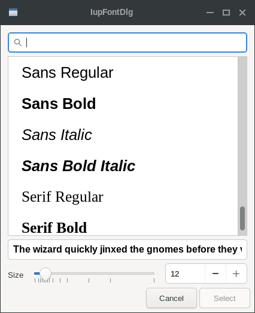
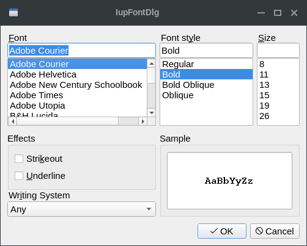
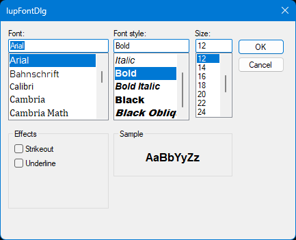
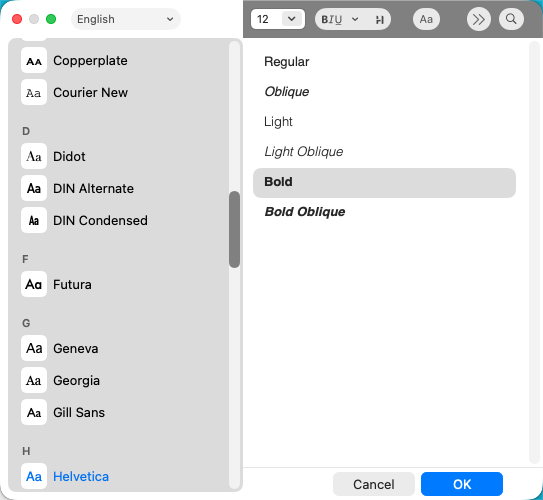

## IupFontDlg

Creates the Font Dialog element. It is a predefined dialog for selecting a font.
The dialog can be shown with the **IupPopup** function only.

### Creation

    Ihandle* IupFontDlg(void);

**Returns:** the identifier of the created element, or NULL if an error occurs.

### Attributes

**PREVIEWTEXT**: the text shown in the preview area.
If not defined, the system will provide a default text.
Supported in GTK 3, Qt, Motif, FLTK, EFL, WinUI, Android, Haiku and WebAssembly.

**COLOR**: The initial color value and the returned selected value if the user pressed the Ok button.
Supported in Win32 and macOS.
In macOS, only the returned value is supported, and only when SHOWCOLOR=YES.

**SHOWCOLOR**: Shows the color selection. Can be "YES" or "NO". Default: "NO".
Supported in Win32 and macOS.

[PARENTDIALOG](../attrib/iup_parentdialog.md) (creation-only): Name of a dialog to be used as parent.
This dialog will always be in front of the parent dialog.

**STATUS** (read-only): defined to "1" if the user pressed the Ok button, "0" or NULL if the user pressed the Cancel button.

[TITLE](../attrib/iup_title.md): Dialog title.

**VALUE**: The initial font value and the selected value returned if the user pressed the Ok button.
Has the same format as the [FONT](../attrib/iup_font.md) attribute.

### Callbacks

[HELP_CB](../call/iup_help_cb.md): Action generated when the Help button is pressed.
Not supported in GTK 4, iOS and QML.

### Notes

The **IupFontDlg** is a native pre-defined dialog not altered by **IupSetLanguage**.

The dialog is mapped only inside **IupPopup**, **IupMap** does nothing.

In Windows, the dialog will be modal relative only to its parent or to the active dialog.

Win32 uses ChooseFont, GTK 3 uses GtkFontChooser, GTK 4 uses GtkFontDialog, macOS uses NSFontPanel, Qt uses QFontDialog, QML uses FontDialog, iOS uses UIFontPickerViewController, and WinUI, Motif, FLTK, EFL, Android, Haiku and WebAssembly use a custom dialog implemented using IUP controls.

### Examples

    Ihandle* dlg = IupFontDlg();

    IupSetAttribute(dlg, "VALUE", "Times New Roman, Bold 20");
    IupSetAttribute(dlg, "TITLE", "IupFontDlg Test");
    IupSetCallback(dlg, "HELP_CB", (Icallback)help_cb);

    IupPopup(dlg, IUP_CURRENT, IUP_CURRENT);

    if (IupGetInt(dlg, "STATUS"))
    {
      printf("OK\n");
      printf("  VALUE(%s)\n", IupGetAttribute(dlg, "VALUE"));
      printf("  COLOR(%s)\n", IupGetAttribute(dlg, "COLOR"));
    }
    else
      printf("CANCEL\n");

    IupDestroy(dlg);

|                                    |                                  |                                   |                                   |
|------------------------------------|----------------------------------|-----------------------------------|-----------------------------------|
| GTK                                | Qt                               | Win32                             | macOS                             |
|  |  |  |  |

### See Also

[IupMessageDlg](iup_messagedlg.md), [IupFileDlg](iup_filedlg.md), [IupPopup](../func/iup_popup.md)
