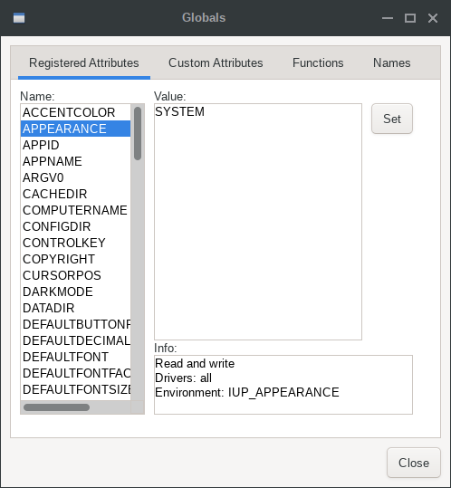

## IupGlobalsDialog

Creates a Globals Dialog. It is a predefined dialog to check and edit global attributes, functions (read-only) and names (read-only) at run time.
It is a standard **IupDialog** constructed with other IUP elements.
The dialog can be shown with any of the show functions **IupShow**, **IupShowXY** or **IupPopup**.

This dialog is intended for developers, to see and inspect their globals.

It contains 4 Tab sections: one for the registered global attributes, one for custom global attributes set by the application, one for the global functions and one for the global names.
The functions and names are just for inspection, and custom attributes should be handled carefully because they may be not strings.
For a registered global attribute, the Info box shows whether it is read-only, write-only or a pointer, the drivers that support it, and its IUP_*name* environment variable when there is one.

### Creation

    Ihandle* IupGlobalsDialog(void);

**Returns:** the identifier of the created dialog, or NULL if an error occurs.

### Attributes

Supports all the [IupDialog](iup_dialog.md) attributes.

### Callbacks

Supports all the [IupDialog](iup_dialog.md) callbacks.

### Examples

    IupShow(IupGlobalsDialog());

The dialog is displayed next.

### See Also

[IupDialog](iup_dialog.md), [IupShow](../func/iup_show.md), [IupShowXY](../func/iup_showxy.md), [IupPopup](../func/iup_popup.md)
