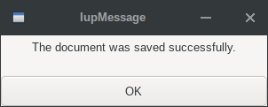
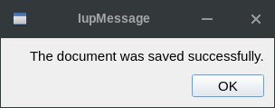
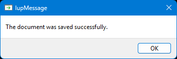
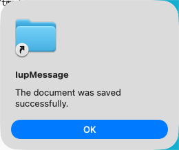

## IupMessage

Shows a modal dialog containing a message. It creates and pops up a **IupMessageDlg**.

### Creation and Show

    void IupMessage(const char *title, const char *message);
    void IupMessagef(const char *title, const char *format, ...);
    void IupMessageV(const char *title, const char *format, va_list arglist);

**title**: dialog title\
**message**: text message contents\
**format**: same format as the C sprintf function

### Notes

The **IupMessage** function shows a dialog centered on the screen, showing the message and the "OK" button.
The '\n' character can be added to the message to indicate line change.

The dialog uses a global attribute called "PARENTDIALOG" as the parent dialog if it is defined.

### Examples

[Browse for Example Files](../../examples/)

|                                    |                                  |                                   |                                   |
|------------------------------------|----------------------------------|-----------------------------------|-----------------------------------|
| GTK                                | Qt                               | Win32                             | macOS                             |
|  |  |  |  |

### See Also

[IupGetFile](iup_getfile.md), [IupListDialog](iup_listdialog.md), [IupAlarm](iup_alarm.md), [IupMessageDlg](iup_messagedlg.md)
