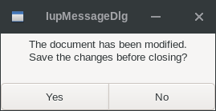
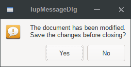
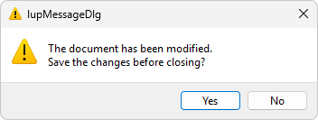
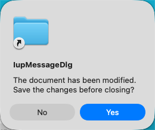

## IupMessageDlg

Creates the Message Dialog element. It is a predefined dialog for displaying a message.
The dialog can be shown with the IupPopup function only.

### Creation

    Ihandle* IupMessageDlg(void);

**Returns:** the identifier of the created element, or NULL if an error occurs.

### Attributes

**BUTTONCANCEL**: Number of the button returned when the dialog is closed without pressing a button. Used only when BUTTONS=CUSTOM.
Default: the last button.

**BUTTONDEFAULT**: Number of the default button.
Can be "1", "2" or "3". "2" is not valid for "OK". "3" is valid only for "YESNOCANCEL". When BUTTONS=CUSTOM, it can be the number of any button.
Default: "1".
Not supported in QML, except when BUTTONS=CUSTOM.

**BUTTONRESPONSE**: Number of the pressed button, starting at 1. Default: "1".
When the dialog is closed without pressing a button, with Esc or with the window close button, it returns the cancel button: "3" for YESNOCANCEL, "2" for OKCANCEL, RETRYCANCEL and YESNO, "1" for OK, and BUTTONCANCEL for CUSTOM.
In Haiku and Android, it can only be closed with a button. In macOS and iOS, Esc closes it only when the buttons include a Cancel, or BUTTONS=CUSTOM.

**BUTTONS**: Buttons configuration. Can have values: "OK", "OKCANCEL", "RETRYCANCEL", "YESNO", "YESNOCANCEL" or "CUSTOM".
Default: "OK". Additionally, the "Help" button is displayed if the HELP_CB callback is defined.
CUSTOM shows the buttons defined by BUTTONTITLEid, in that order. In macOS and Android the first button is the rightmost, or the top one when the buttons are stacked, and in iOS the cancel button is placed last.
When the native dialog cannot show those buttons, an IUP dialog with the same buttons and without the DIALOGTYPE icon is shown instead: in Haiku and GNUstep with more than three buttons, in WinUI with more than three buttons or when BUTTONCANCEL is not the third of three, and always in FLTK, QML and WebAssembly.

**BUTTONSTYLE** [Android and iOS Only]: visual style applied to all buttons. Same values as [IupButton](../elem/iup_button.md)'s BUTTONSTYLE ("FILLED", "TONAL", "OUTLINED", "ELEVATED", "TEXT"). When unset, the default action gets a filled look and the rest a gray look (matching the platform's native alert).

**BUTTONTITLEid**: Title of each button when BUTTONS=CUSTOM. id starts at 1, the buttons are the consecutive ids defined from 1. Without BUTTONTITLE1, CUSTOM behaves as OK.
The "&" character defines a mnemonic in the drivers that support them, elsewhere it is removed. Use "&&" to show the "&" character.

**CORNERSTYLE** [Android and iOS Only]: corner shape applied to all buttons. Same values as [IupButton](../elem/iup_button.md)'s CORNERSTYLE ("SMALL", "MEDIUM", "LARGE", "CAPSULE"). When unset, the platform's stock default is used (capsule on Material 3 and iOS 26 Liquid Glass).

**DIALOGTYPE**: Type of dialog defines which icon will be displayed beside the message text.
Can have values: "MESSAGE" (No Icon), "ERROR" (Stop-sign), "WARNING" (Exclamation-point), "QUESTION" (Question-mark) or "INFORMATION" (Letter "i").
Default: "MESSAGE".
The icon is not displayed in GTK 4 and QML.

[PARENTDIALOG](../attrib/iup_parentdialog.md) (creation-only): Name of a dialog to be used as parent.
This dialog will always be in front of the parent dialog.
In Motif, if not defined, the dialog is not modal.

[TITLE](../attrib/iup_title.md): Dialog title.

**VALUE**: Message text.

### Callbacks

[HELP_CB](../call/iup_help_cb.md): Action generated when the Help button is pressed.
Not supported in WinUI, GTK 4, FLTK, Haiku and WebAssembly.

### Notes

The **IupMessageDlg** is a native pre-defined dialog not altered by **IupSetLanguage**.

The dialog is mapped only inside **IupPopup**, **IupMap** does nothing.

The **IupMessage** function creates and shows an **IupMessageDlg**.

In Win32, each different DIALOGTYPE plays a different system beep, and PARENTDIALOG makes the dialog modal relative only to its parent.

The underlying native widget per driver:

- **Win32**: TaskDialogIndirect.
- **WinUI**: ContentDialog hosted on the parent dialog's XamlRoot.
- **GTK 3**: gtk_message_dialog (gtk_dialog_run).
- **GTK 4**: GtkAlertDialog (4.10+).
- **Motif**: XmCreateMessageDialog / XmCreateMessageBox.
- **Cocoa**: NSAlert.
- **Cocoa Touch**: custom UIView.
- **Qt**: QMessageBox.
- **QML**: MessageDialog.
- **FLTK**: fl_message / fl_choice_n.
- **EFL**: custom dialog window (efl_ui_win).
- **Android**: MaterialAlertDialogBuilder.
- **Haiku**: BAlert.

The (x,y) position from IupPopup is ignored by the native widget on all drivers except Qt, which honors it only when there is no parent.

### Examples

    Ihandle* dlg = IupMessageDlg();

    IupSetAttribute(dlg, "DIALOGTYPE", "WARNING");
    IupSetAttribute(dlg, "TITLE", "IupMessageDlg Test");
    IupSetAttribute(dlg, "BUTTONS", "OKCANCEL");
    IupSetAttribute(dlg, "VALUE", "Message Text\nSecond Line");
    IupSetCallback(dlg, "HELP_CB", (Icallback)help_cb);

    IupPopup(dlg, IUP_CURRENT, IUP_CURRENT);

    printf("BUTTONRESPONSE(%s)\n", IupGetAttribute(dlg, "BUTTONRESPONSE"));

    IupDestroy(dlg);  

With custom buttons:

    Ihandle* dlg = IupMessageDlg();

    IupSetAttribute(dlg, "DIALOGTYPE", "QUESTION");
    IupSetAttribute(dlg, "VALUE", "Save changes to \"notes.txt\"?");
    IupSetAttribute(dlg, "BUTTONS", "CUSTOM");
    IupSetAttribute(dlg, "BUTTONTITLE1", "&Save");
    IupSetAttribute(dlg, "BUTTONTITLE2", "&Discard");
    IupSetAttribute(dlg, "BUTTONTITLE3", "Save &All");
    IupSetAttribute(dlg, "BUTTONTITLE4", "&Cancel");

    IupPopup(dlg, IUP_CENTERPARENT, IUP_CENTERPARENT);

    int response = IupGetInt(dlg, "BUTTONRESPONSE");  /* 1 to 4, and 4 when closed */

    IupDestroy(dlg);

|                                       |                                     |                                      |                                      |
|---------------------------------------|-------------------------------------|--------------------------------------|--------------------------------------|
| GTK                                   | Qt                                  | Win32                                | macOS                                |
|  |  |  |  |

### See Also

[IupMessage](iup_message.md), [IupListDialog](iup_listdialog.md), [IupAlarm](iup_alarm.md), [IupGetFile](iup_getfile.md), [IupPopup](../func/iup_popup.md)
