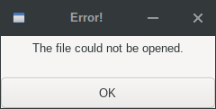
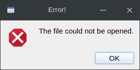
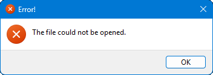
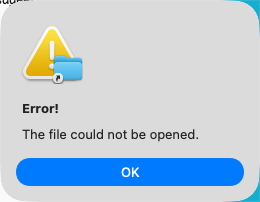

## IupMessageError

Shows a modal dialog containing an error message.
It creates and pops up an **IupMessageDlg** with DIALOGTYPE=ERROR.

### Creation and Show

    void IupMessageError(Ihandle* parent, const char *message);

**parent**: parent dialog, can be NULL.\
**message**: text message contents. It can be a language pre-defined string without the "_@" prefix.

### Notes

If the parent is NULL, the global attribute "PARENTDIALOG" is used as the parent dialog.

The dialog title will be the same title of the parent dialog, or "Error!" when there is no parent or the parent has no title.

The dialog is shown centered relative to its parent.

### Examples

[Browse for Example Files](../../examples/)

|                                         |                                       |                                        |                                        |
|-----------------------------------------|---------------------------------------|----------------------------------------|----------------------------------------|
| GTK                                     | Qt                                    | Win32                                  | macOS                                  |
|  |  |  |  |

### See Also

[IupGetFile](iup_getfile.md), [IupListDialog](iup_listdialog.md), [IupAlarm](iup_alarm.md), [IupMessage](iup_message.md), [IupMessageDlg](iup_messagedlg.md)
