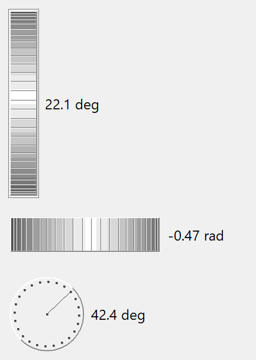
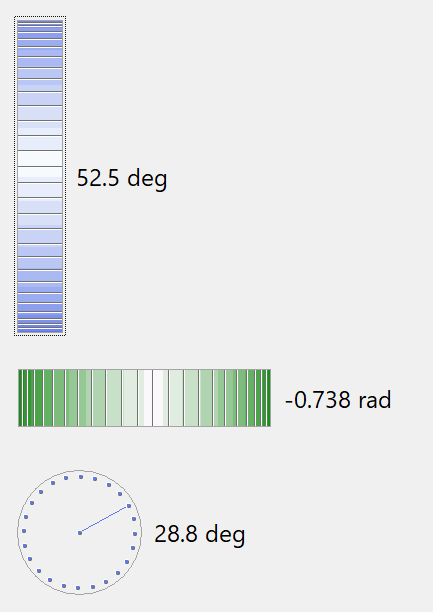

## IupDial

Creates a dial for regulating a given angular variable.
It inherits from [IupCanvas](../elem/iup_canvas.md).

### Creation

    Ihandle* IupDial(const char *orientation);

**orientation**: optional dial orientation, can be NULL. See ORIENTATION attribute.

**Returns:** the identifier of the created element, or NULL if an error occurs.

### Attributes

**DENSITY**: number of lines per pixel in the handle of the dial. Default: "0.2".

[EXPAND](../attrib/iup_expand.md): Default: "NO".

**FLAT**: use a 1 pixel flat border instead of a 3-pixel sunken border.
Can be YES or NO. Default: "YES".

**FLATCOLOR**: color of the border when FLAT=YES. Default: "160 160 160".

[FGCOLOR](../attrib/iup_fgcolor.md): foreground color.
Default: "64 64 64".

[SIZE](../attrib/iup_size.md) (non-inheritable): the initial size is "16x80", "80x16" or "40x36" according to the dial orientation.
Set to NULL to allow the automatic layout to use smaller values.

**ORIENTATION** (creation-only) (non-inheritable): dial layout configuration "VERTICAL", "HORIZONTAL" or "CIRCULAR".
Default: "HORIZONTAL". Vertical increments when moved up, and decrements when moved down.
Horizontal increments when moved right, and decrements when moved left.
Circular increments when moved counterclockwise, and decrements when moved clockwise.

**VALUE** (non-inheritable): The dial angular value always in radians.
The value is reset to zero when the interaction is started, except for ORIENTATION=CIRCULAR.
When orientation is vertical or horizontal, the dial measures relative angles.
When orientation is circular, the dial measures absolute angles, where the origin is at 3 O'clock.

> 
>
> ------------------------------------------------------------------------

[ACTIVE](../attrib/iup_active.md), [BGCOLOR](../attrib/iup_bgcolor.md), [FONT](../attrib/iup_font.md), [SCREENPOSITION](../attrib/iup_screenposition.md), [POSITION](../attrib/iup_position.md), [MINSIZE](../attrib/iup_minsize.md), [MAXSIZE](../attrib/iup_maxsize.md), [WID](../attrib/iup_wid.md), [TIP](../attrib/iup_tip.md), [RASTERSIZE](../attrib/iup_rastersize.md), [ZORDER](../attrib/iup_zorder.md), [VISIBLE](../attrib/iup_visible.md), [THEME](../attrib/iup_theme.md): also accepted.

### Callbacks

**VALUECHANGED_CB**: Called after the value was interactively changed by the user.

    int function(Ihandle *ih);

**ih**: identifier of the element that activated the event.

> 
>
> ------------------------------------------------------------------------

[MAP_CB](../call/iup_map_cb.md), [UNMAP_CB](../call/iup_unmap_cb.md), [DESTROY_CB](../call/iup_destroy_cb.md), [GETFOCUS_CB](../call/iup_getfocus_cb.md), [KILLFOCUS_CB](../call/iup_killfocus_cb.md), [ENTERWINDOW_CB](../call/iup_enterwindow_cb.md), [LEAVEWINDOW_CB](../call/iup_leavewindow_cb.md), [K_ANY](../call/iup_k_any.md), [HELP_CB](../call/iup_help_cb.md): All common callbacks are supported.

### Notes

When the keyboard arrows are pressed and released, VALUECHANGED_CB is called for the press and for the release.
While the key is held down, VALUECHANGED_CB is also called for every repetition.

When the wheel is rotated, VALUECHANGED_CB is called, and the wheel increments the last angle the dial was rotated.

In all cases, the value is incremented or decremented by PI/10 (18 degrees).

With Shift pressed while using the arrow keys, the increment is reduced to PI/100 (1.8 degrees).
The Home key resets the circular dial to 0.

### Examples

[Browse for Example Files](../../examples/)

\
Regular

\
Flat=YES and fgcolor

### See Also

[IupCanvas](../elem/iup_canvas.md)
