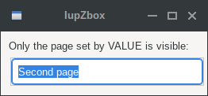

## IupZbox

Creates a void container for composing elements in hidden layers with only one layer visible.
It is a box that piles up the children it contains; only one child is visible.

It does not have a native representation.

Zbox works by changing the VISIBLE attribute of its children, so if any of the grandchildren has its VISIBLE attribute directly defined then Zbox will NOT change its state.

### Creation

    Ihandle* IupZbox(Ihandle *child, ...);
    Ihandle* IupZboxV(Ihandle* child, va_list arglist);
    Ihandle* IupZboxv(Ihandle **children);

**child, ...**: List of the elements that will be placed in the box.
NULL must be used to define the end of the list in C.
It can be empty, but in C must have at least the NULL terminator.

**Returns:** the identifier of the created element, or NULL if an error occurs.

### Attributes

**ALIGNMENT** (non-inheritable): Defines the alignment of the visible child. Possible values:

"NORTH", "SOUTH", "WEST", "EAST",\
"NE", "SE", "NW", "SW",\
"ACENTER".

Default: "NW".

**CHILDSIZEALL** (non-inheritable): compute the natural size using all children.
If set to NO will compute using only the visible child. Default: "YES".

[EXPAND](../attrib/iup_expand.md) (non-inheritable): Default: "YES".

**VALUE** (non-inheritable): The visible child accessed by its name.
The value passed must be the name of one of the children contained in the zbox.
Use [IupSetHandle](../func/iup_sethandle.md) or [IupSetAttributeHandle](../func/iup_setattributehandle.md) to associate a child to a name.
When the value is changed the selected child is made visible and all other children are made invisible, regardless of their previous visible state.

**VALUE_HANDLE** (non-inheritable): The visible child accessed by its handle.
The value passed must be the handle of a child contained in the zbox.
When the zbox is created, the first element inserted is set as the visible child.

**VALUEPOS** (non-inheritable): The visible child accessed by its position.
The value passed must be the index of a child contained in the zbox, starting at 0.

[SIZE](../attrib/iup_size.md) / [RASTERSIZE](../attrib/iup_rastersize.md) (non-inheritable): The default size is the smallest size that fits its largest child.
All child elements are considered even invisible ones, except when FLOATING=YES in a child.

**WID** (read-only): returns -1 if mapped.

> 
>
> ------------------------------------------------------------------------

[FONT](../attrib/iup_font.md), [CLIENTSIZE](../attrib/iup_clientsize.md), [CLIENTOFFSET](../attrib/iup_clientoffset.md), [POSITION](../attrib/iup_position.md), [MINSIZE](../attrib/iup_minsize.md), [MAXSIZE](../attrib/iup_maxsize.md), [THEME](../attrib/iup_theme.md): also accepted.

### Attributes (at Children)

[FLOATING](../attrib/iup_floating.md) (non-inheritable) **(at children only)**: If a child has FLOATING=YES then its size and position will be ignored by the layout processing.
Default: "NO".

### Notes

The box can be created with no elements and be dynamically filled using [IupAppend](../func/iup_append.md) or [IupInsert](../func/iup_insert.md).

Its children automatically receive a name when the child is appended or inserted into the zbox.

If a child that is hidden by the zbox has its VISIBLE attribute changed then it can be made visible regardless of the zbox configuration.
For the zbox to behave as an **IupTabs** use native containers as immediate children of the zbox, like **IupScrollBox**, **IupTabs**, **IupFrame** or **IupBackgroundBox**.

### Examples

[Browse for Example Files](../../examples/)

### See Also

[IupHbox](iup_hbox.md), [IupVbox](iup_vbox.md)
